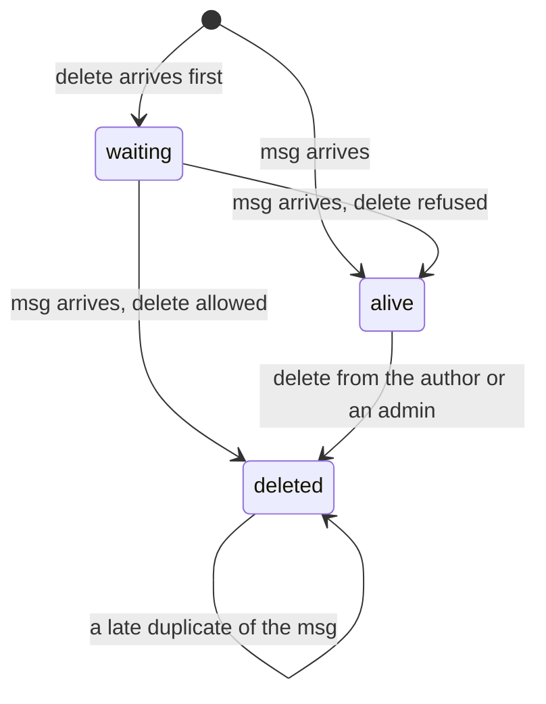
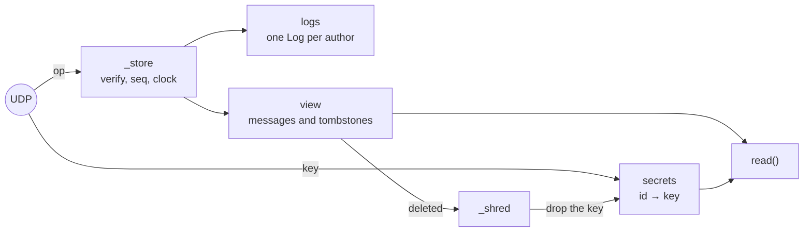
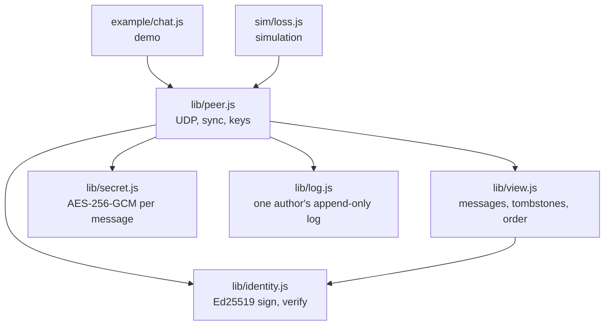
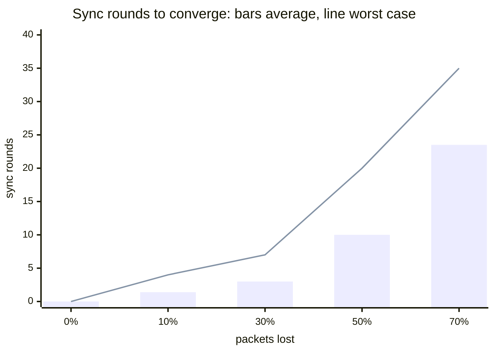

# tombstone

How do you delete a message in a peer-to-peer chat? There's no server to delete it
from: every peer keeps its own copy of an append-only log, and nothing in a log can
be removed. This is a small chat on raw UDP in Node.js, no dependencies, built one
problem at a time until deleting works for everyone. Each piece was added because the
previous one left a visible gap, so this is also a record of why P2P apps delete the
way they do.

## How it works

```
op      = signed { type, seq, clock, author, sig }    a msg carries { iv, box }, a delete carries { target }
author  = an Ed25519 public key                       nobody can write as someone else
id      = author/seq                                  nobody can reuse someone else's id
delete  = a new op that marks its target              the original stays in every log: a tombstone
order   = (clock, author)                             the same on every peer
shred   = throw the message key away                  the box stays in the logs, unreadable
```

A message has one of three fates on each peer, and every peer ends in the same one
whatever order the ops arrive in:



Inside a peer, the log only grows. What the screen shows is computed from it, and
the text needs a key that lives outside it:



| Problem                                 | What solves it                                                        |
| --------------------------------------- | --------------------------------------------------------------------- |
| a log can't remove anything             | **tombstone**: a delete is a new op that marks its target             |
| anyone could delete anything            | only the author or an admin, checked by every peer when it applies    |
| anyone could write as anyone            | every op is signed, the author is the public key                      |
| a delete can arrive before its message  | it waits in `_pending` until the message comes                        |
| a late duplicate could undo a delete    | the first copy of a message wins, later ones are ignored              |
| packets get lost, peers go offline      | `have`: "I have this much of each log", the other side sends the rest |
| each peer would show its own order      | Lamport clock, author key to break ties                               |
| the deleted text is still on every disk | each message has its own key, and the key dies with the tombstone     |

The view is a CRDT: applying the same ops in any order, any number of times, gives
the same result. Tested on all 120 arrival orders of 5 ops: one result.

---

## Run it

```bash
npm test                 # 35 tests
npm run coverage         # fails below 100% lines, branches and functions
npm run demo             # two peers, 50% packet loss, one message deleted
npm run sim              # sync rounds needed as packet loss grows
```

```
daniel sees:
  [1] daniel: (message deleted)
  [1] bob: hey
  [3] daniel: how are you guys ?
  [4] bob: good, and you?

bob sees:
  [1] daniel: (message deleted)
  [1] bob: hey
  [3] daniel: how are you guys ?
  [4] bob: good, and you?

oi is still in bob log, encrypted: kEGg3x7VJQrWkD0ov2hb5ud9
bob still has its key: false
daniel still has its key: false
```

---

## Code



Read it bottom-up: `log.js`, `identity.js`, `secret.js`, `view.js`, then `peer.js`.

---

## Wire format

One JSON object per UDP datagram, with `t` saying what it is:

| `t`    | Carries                      | Accepted from        | Answer                                  |
| ------ | ---------------------------- | -------------------- | --------------------------------------- |
| `op`   | `op`: one signed op          | anyone (it's signed) | none                                    |
| `have` | `have`: `{ author: length }` | connected peers only | every op they're missing, and every key |
| `key`  | `id`, `key`                  | connected peers only | none                                    |

And the op itself:

| Field    | In       | Meaning                                                       |
| -------- | -------- | ------------------------------------------------------------- |
| `type`   | every op | `'msg'` or `'delete'`                                         |
| `seq`    | every op | position in the author's log, from 0                          |
| `clock`  | every op | Lamport clock: 1 + the highest clock the author had seen      |
| `author` | every op | the author's public key, set by `sign`                        |
| `sig`    | every op | Ed25519 over everything else                                  |
| `iv`     | `msg`    | AES-GCM nonce, public                                         |
| `box`    | `msg`    | ciphertext + auth tag. The text itself never travels in an op |
| `target` | `delete` | id of the message to delete: `author/seq`                     |

`seq` and `clock` are signed, so nobody can renumber an op. Every field coming from the
network is checked before use, and anything malformed is dropped.

---

## How it evolved

Each step was added because the previous one left a visible gap.

| Step             | Added                                           | What broke, or what it showed                                                                                                                                                                               |
| ---------------- | ----------------------------------------------- | ----------------------------------------------------------------------------------------------------------------------------------------------------------------------------------------------------------- |
| Append-only log  | frozen ops, `seq` from `push() - 1`             | nothing can be removed, so deleting has to be something you add                                                                                                                                             |
| View + tombstone | a delete marks its target, the text is hidden   | the screen is right, but the original text is still in the log                                                                                                                                              |
| Permission       | only the author or an admin                     | `author` was just a string: anyone could write `author: 'daniel'`                                                                                                                                           |
| Signatures       | Ed25519, the author is the public key           | **bug:** every forged op verified. `crypto.verify` returns false on a bad signature, it doesn't throw, and the result was ignored                                                                           |
| Convergence      | pending deletes, ignore duplicate messages      | 120 arrival orders of the same 5 ops gave 2 different chats: an early delete was dropped, and a late duplicate brought a message back                                                                       |
| Two peers on UDP | chaos: packets delayed and duplicated           | **bug:** `_publish` applied ops to a `new View()` thrown away, so nobody saw their own messages. Content converged, display order didn't                                                                    |
| Sync             | per-author logs, signed `seq`, `have`           | the array log couldn't take ops out of order (seq 4 before 3), so it became a Map by seq, with `length` = the run with no gap. Without `have`, a lost tombstone kept the message alive on that peer forever |
| Lamport clock    | `clock = max(seen)`, order by `(clock, author)` | **bug:** `clock++` per op received instead of `max`. Fine with 2 peers; with 3, a reply can sort before its question                                                                                        |
| Crypto-shredding | a key per message, sent outside the log         | **bug:** ids were picked by the author, so another peer could reuse one and take over a message. Ids became `author/seq`                                                                                    |
| Shred on delete  | `_shred` drops the key of every deleted message | **bug:** `messages(m => ...)` passed a callback to a method that takes none. The screen said deleted while the key was still in memory                                                                      |

Rules that came out of it: a delete is checked when it's applied, on every peer, since
there's no server to refuse it; ops are accepted from anyone because they're signed,
but `have` and keys only from connected peers; and the view never depends on keys,
which differ from peer to peer.

---

## Results

`npm run sim`: two peers, chaos on (packets delayed 0-200 ms, 30% duplicated), 10
messages and 2 deletes sent at once, then a sync every 250 ms until both screens match
and both deleted keys are gone:



| Packets lost | Converged with no sync | Sync rounds, average | Sync rounds, worst |
| ------------ | ---------------------- | -------------------- | ------------------ |
| 0%           | 20 / 20                | 0                    | 0                  |
| 10%          | 4 / 20                 | 1.4                  | 4                  |
| 30%          | 0 / 20                 | 3.0                  | 7                  |
| 50%          | 0 / 20                 | 10.0                 | 20                 |
| 70%          | 0 / 10                 | 23.5                 | 35                 |

- **Every trial converged**, at every loss rate. Sync never gives up, it only takes longer.
- **Even 10% loss breaks most chats without sync.** 22 packets have to arrive, so
  losing at least one is the normal case.
- **Cost grows faster than the loss.** A missing op needs two packets to survive in
  the same round, the `have` and the answer, so each round succeeds with roughly (1 − loss)².
  At 50% that's 25%; at 70%, 9%.

---

## Tests

35 tests, 100% of lines, branches and functions across `lib/`, using only `node:test`
and its built-in coverage. Network tests use real UDP sockets. Randomness is mocked
where a branch depends on it (duplicate or not), and the view is checked on every
arrival order of the same ops rather than on a few chosen ones. The suite passed 8
runs in a row.

---

## Known limitations

| Limitation                         | Why it matters                                                                                                                                      |
| ---------------------------------- | --------------------------------------------------------------------------------------------------------------------------------------------------- |
| Keys travel in plain UDP           | Anyone who can see the traffic gets every key. Real P2P apps run over encrypted connections (Noise, in Hyperswarm).                                 |
| Shredding can't reach a copy       | A peer that read a message, or saved its key, keeps it. What's guaranteed is that nothing readable is left on honest peers and new peers get noise. |
| Every sync resends every key       | Cost grows with the size of the chat. A key should be resent only to who doesn't have it.                                                           |
| `_pending` has no limit            | Anyone can send millions of deletes for messages that will never exist.                                                                             |
| The clock can be inflated          | One op with a huge clock pushes everyone's clock to it.                                                                                             |
| An author can fork their own log   | Two different ops with the same `seq`, one to each peer: each keeps the first it saw. Hypercore detects this with a signed Merkle tree.             |
| Admins are fixed at start          | No op to add or remove one.                                                                                                                         |
| One op per datagram, no size limit | A big message would go over the path MTU (~1200 B) and be fragmented or dropped.                                                                    |
| Localhost only                     | No NAT traversal. Two peers behind different routers can't reach each other directly.                                                               |

---

## Background

- Lamport, _Time, Clocks, and the Ordering of Events in a Distributed System_ (1978): https://amturing.acm.org/p558-lamport.pdf
- Shapiro, Preguiça, Baquero, Zawirski, _Conflict-free Replicated Data Types_ (2011): https://hal.sorbonne-universite.fr/inria-00609399v1
- Hypercore, the append-only log this mimics: https://github.com/holepunchto/hypercore
- Autobase, many writers ordered into one view: https://github.com/holepunchto/autobase
- Pear docs: https://docs.pears.com
- Node `crypto` (Ed25519, AES-GCM) and `dgram`: https://nodejs.org/api/crypto.html, https://nodejs.org/api/dgram.html
